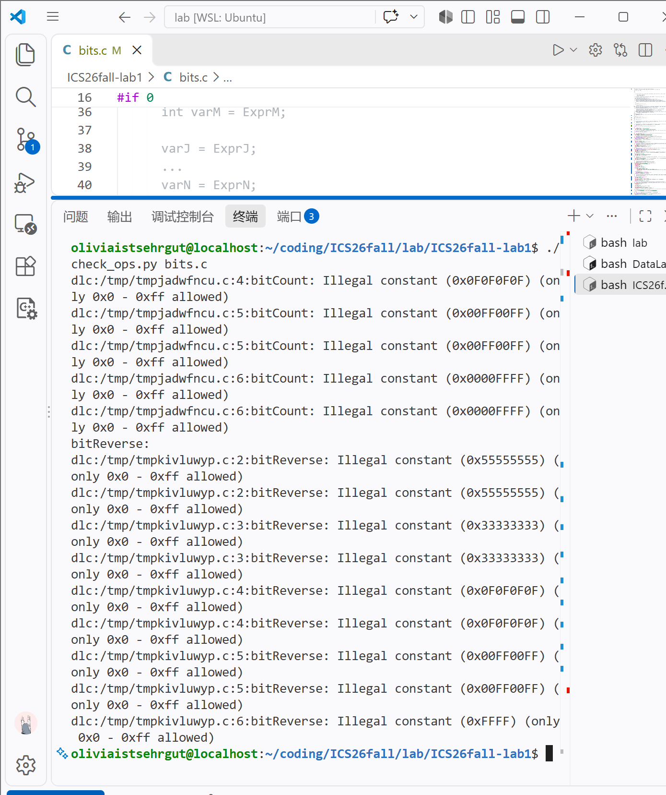
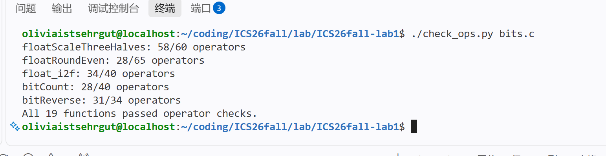

# 实验报告

- **姓名：** 李悠然
- **学号：** 23300120072

## 实验环境与结果

### `./check_ops.py bits.c` 运行截图

### `./btest` 运行截图

## 函数实现思路

### P1 `signMask`

将整数 1 左移 31 位，得到只设置最高位的掩码 `0x80000000`。

### P2 `bitXor`

利用德摩根定律，用 `~` 和 `&` 组合实现异或：`(x | y) & ~(x & y)` 的等价形式。

### P3 `negativePart`

先用 `x >> 31` 提取符号位，再与 `x` 相与；对负数取反加一得到相反数，非负数则得到 0。

### P4 `copyByteWithin`

根据源字节和目标字节计算移位量，取出源字节后移到目标位置；先清除目标字节，再用按位或写入源字节。

### P5 `logicalShift`

先进行算术右移，再构造低位全为 1 的掩码，屏蔽算术右移补出的高位 1。

### P6 `swapNibblePairs`

分别取出每个字节的低四位和高四位，将低四位左移、高四位右移，最后按位或合并。

### P7 `secondLowestZeroBit`

利用 `~x & (x + 1)` 找到最低位的 0 所对应的进位结构，再加回原数并重复类似操作，得到第二个最低位 0 的掩码。

### P8 `oddParity`

依次对半字节、字节和更大的分组做异或折叠，得到所有位的异或结果；最后取反，使 1 表示原数中 1 的个数为偶数。

### P9 `rotateRightBits`

将右移部分做逻辑右移，再把被移出的高位通过左移放回低位，最后按位或合并。移位量用 `& 31` 处理边界。

### P10 `roundEvenPow2`

把数分成商和余数，比较余数与半个 `2^n` 的大小；大于一半时进位，恰好一半时根据商的奇偶性决定是否进位。

### P11 `midpointTowardFirst`

用 `(x & y) + ((x ^ y) >> 1)` 计算不会溢出的平均值。若两数和为奇数，则根据 `x` 与 `y` 的大小关系决定向更接近第一个参数的整数调整。

### P12 `isBetweenEitherOrder`

分别判断 `x` 是否位于 `[a,b]` 和 `[b,a]` 两种端点顺序的闭区间内。比较时先处理符号不同的情况，再通过相减的符号判断大小。

### P13 `mul5Sat`

用左移加法计算 `5*x`，同时根据输入符号和边界比较检测溢出；溢出时选择 `INT_MAX` 或 `INT_MIN`，否则返回正常乘积。

### P14 `classifyAdd3`

将三个数拆成符号位和绝对值部分，分别累加低 31 位并记录进位，再结合三个符号和进位判断数学和是否超过有符号整数范围。

### P15 `floatScaleThreeHalves`

拆分浮点数的符号、阶码和尾数，用整数尾数计算乘以 3/2，并在规格化、非规格化和舍入到偶数之间进行处理；NaN、无穷和零单独保留。

### P16 `floatRoundEven`

根据阶码判断小数位范围，提取整数部分和剩余部分，按最近偶数规则舍入；再重新规格化并组合符号、阶码和尾数。

### P17 `float_i2f`

先确定整数的符号和最高有效位，得到浮点阶码；保留 23 位尾数，并依据被截断部分按最近偶数规则舍入，最后组装结果。

### P18 `bitCount`

采用分治累加：先统计相邻 1 位，再统计 2 位、4 位、8 位和 16 位分组中的 1 的数量，最终得到总数。

### P19 `bitReverse`

依次交换相邻 1 位、2 位、4 位、8 位和 16 位分组的位置，逐级完成 32 位整数的比特反转。

